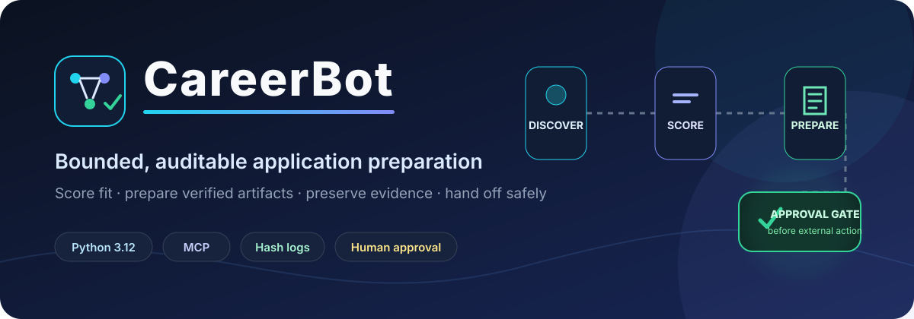
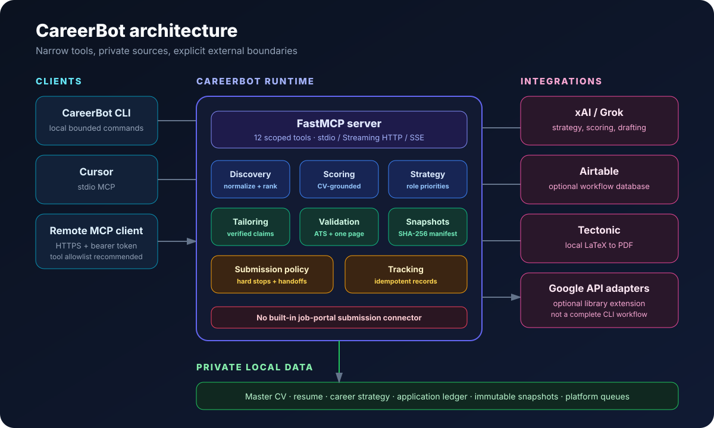
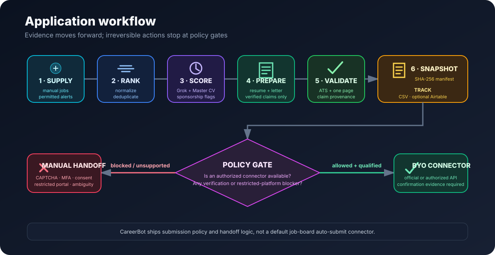

<div align="center">

[](https://www.python.org/)
[](https://modelcontextprotocol.io/)
[](LICENSE)
[](#current-limitations)

</div>

# CareerBot

CareerBot is an open-source Python and MCP toolkit for scoring job fit, preparing verified
application artifacts, preserving immutable evidence, and tracking application state. It is
designed for bounded sessions and explicit handoffs, not unattended job-board automation.

## What it does

- Normalizes, ranks, and deduplicates jobs supplied manually or through permitted adapters.
- Scores fit against a private, hash-verified Master CV using xAI's Responses API.
- Generates role positioning, tailored LaTeX resumes, and concise cover letters.
- Enforces deterministic ATS, claim-provenance, and one-page PDF checks.
- Saves immutable application snapshots with SHA-256 manifests.
- Tracks prepared and submitted applications locally and optionally in Airtable.
- Exposes 12 focused tools through local stdio or authenticated remote MCP.

## What it deliberately does not do

- It does not ship LinkedIn, JobsDB, JobThai, or other job-board scraping connectors.
- It does not ship a default portal submission connector.
- It never bypasses CAPTCHA, MFA, identity checks, consent, declarations, or access controls.
- It does not treat generated or proposed projects as completed experience.

## Architecture



## Workflow



## Quick start

Requirements: Python 3.12+, [uv](https://docs.astral.sh/uv/), and
[Tectonic](https://tectonic-typesetting.github.io/) for PDF rendering.

```bash
git clone https://github.com/Sai21112000/CareerBot.git
cd CareerBot
uv sync --extra dev
cp .env.example .env
cp data/master_resume.tex.example data/master_resume.tex
cp AGENTS.md.example AGENTS.md
chmod 600 .env data/master_resume.tex AGENTS.md
uv run careerbot --help
```

Replace every `[VERIFIED ...]` marker in `data/master_resume.tex`. Put supporting `.tex`, `.txt`,
or `.md` sources under the ignored `data/master_cv/` directory. CareerBot treats those private
sources as the factual boundary for generated claims.

At minimum, model-backed commands need:

```dotenv
CAREERBOT_XAI_API_KEY=
CAREERBOT_XAI_MODEL=grok-4.6
```

Optional Airtable tracking uses `CAREERBOT_AIRTABLE_PAT` and
`CAREERBOT_AIRTABLE_BASE_ID`. Keep credentials in `.env` or an operating-system secret store.

## CLI

```bash
uv run careerbot triage --input examples/jobs.json --max-jobs 10
uv run careerbot --profile review apply --job examples/job.json
uv run careerbot --profile review batch-apply --queue examples/review_queue.json
uv run careerbot follow-up sync --limit 20
uv run careerbot reconcile --limit 50
uv run careerbot verify-snapshot snapshots/<snapshot-id>
```

- `triage` performs local heuristic ranking and deduplication. LLM fit scoring is available through
  the MCP `score_job` tool and the `apply` preparation path.
- `apply` scores, drafts, validates, compiles, snapshots, and records a prepared local application.
- `batch-apply` repeats preparation within configured count and time limits, skipping known keys.
- `follow-up sync` currently lists due local records; it does not send messages.
- `reconcile` currently reports local record and Airtable configuration readiness.
- `verify-snapshot` checks artifact sizes and SHA-256 hashes against the manifest.

## Execution profiles

- `dry_run`: intended for local inspection and simulation.
- `review`: prepares local artifacts while requiring review before external actions.
- `auto`: reserved for explicitly authorized connectors that have passed supervised qualification.

The project is alpha: profiles are not yet a centralized authorization layer for every local write.
`apply` creates a local snapshot and CSV record in every profile. No shipped command submits to a
job portal. Treat `auto` as unavailable until you provide and qualify an authorized connector.

Shared hard stops apply regardless of profile: CAPTCHA, MFA, identity verification, consent,
declarations, ambiguous answers, restricted platforms, and unsupported connectors.

Configure conservative limits:

```dotenv
CAREERBOT_MAX_JOBS_PER_RUN=20
CAREERBOT_MAX_APPLICATIONS_PER_RUN=5
CAREERBOT_MAX_RUN_MINUTES=30
```

## Agent runbooks

The optional `.agent/` layer contains a career-positioning consultant, resume-family classifier,
and bounded runbooks for strategy refresh, daily triage, batch preparation, follow-up review, and
status reconciliation. These are operator instructions, not a claim that every step is implemented
as an unattended Python workflow. Configure private constraints in ignored `AGENTS.md`.

## MCP

The committed `.mcp.json` starts a local stdio server in Cursor:

```bash
uv run careerbot-mcp
```

The server exposes:

- Strategy: `consult_career_positioning`, `save_career_strategy`, `get_career_strategy`
- Jobs: `search_jobs`, `score_job`
- Artifacts: `tailor_resume`, `generate_cover_letter`, `save_application_snapshot`,
  `verify_snapshot`
- Tracking and policy: `track_application`, `submission_hard_stops`, `assess_submission`

For a remote MCP client, run Streaming HTTP behind an HTTPS reverse proxy:

```bash
CAREERBOT_MCP_TRANSPORT=streamable-http \
CAREERBOT_MCP_HOST=127.0.0.1 \
CAREERBOT_MCP_PORT=8000 \
CAREERBOT_MCP_AUTH_TOKEN='<strong-random-token>' \
uv run careerbot-mcp
```

The local endpoint is `http://127.0.0.1:8000/mcp`. Configure the remote client with the public
HTTPS `/mcp` URL and the same bearer token. Allowlist only required tools. The included static
token verifier is suitable for development; use an OAuth/JWT provider for production.

## Integrations

- **xAI / Grok:** model-backed strategy, scoring, resume tailoring, and cover-letter generation.
- **Airtable:** optional application tracking through a least-privilege PAT. Expected tables and
  fields are documented in `data/airtable_schema.json`.
- **Tectonic:** local LaTeX compilation and one-page validation.
- **Google APIs:** injectable Gmail and Calendar adapters are available through the `google`
  optional dependency. They are library extensions, not complete CLI synchronization commands.

Install Google dependencies with:

```bash
uv sync --extra google
```

## Private data

These paths are intentionally ignored:

- `.env` and OAuth credentials
- `AGENTS.md`
- `Resume/`
- `data/master_resume.tex` and `data/master_cv/`
- `data/applications_log.csv`
- career-strategy drafts and snapshots
- application snapshots and active platform queues

Public templates are provided as `AGENTS.md.example`, `data/master_resume.tex.example`, and
`data/applications_log.csv.example`. Never force-add ignored private files.

## Repository layout

- `src/job_agent/`: typed domain models, CLI, scoring, strategy, validation, tracking, and policy.
- `mcp_servers/job_agent/`: FastMCP composition root and tool adapters.
- `.agent/`: optional agent definitions, skills, and bounded workflow runbooks.
- `examples/`: fictional job inputs and command examples.
- `data/`: public templates and integration schemas; private runtime files are ignored.
- `workspaces/`: per-platform instructions; active queues and logs are ignored.
- `tests/`: offline unit and integration-contract tests.

## Current limitations

- Discovery requires caller-supplied jobs, parsed alerts, or a permitted adapter.
- There is no shipped portal submission connector.
- Google adapters are not wired into CLI follow-up synchronization.
- CLI reconciliation reports readiness; it does not yet perform full remote-to-local convergence.
- Execution profiles are an operator contract, not a centralized authorization system for every
  local write.
- The project is alpha and should begin with fictional inputs and development credentials.

## Development

```bash
uv sync --extra dev
uv run pytest
uv run ruff check .
uv run mypy src/job_agent mcp_servers
uv build
```

## License

CareerBot is released under the [MIT License](LICENSE).
