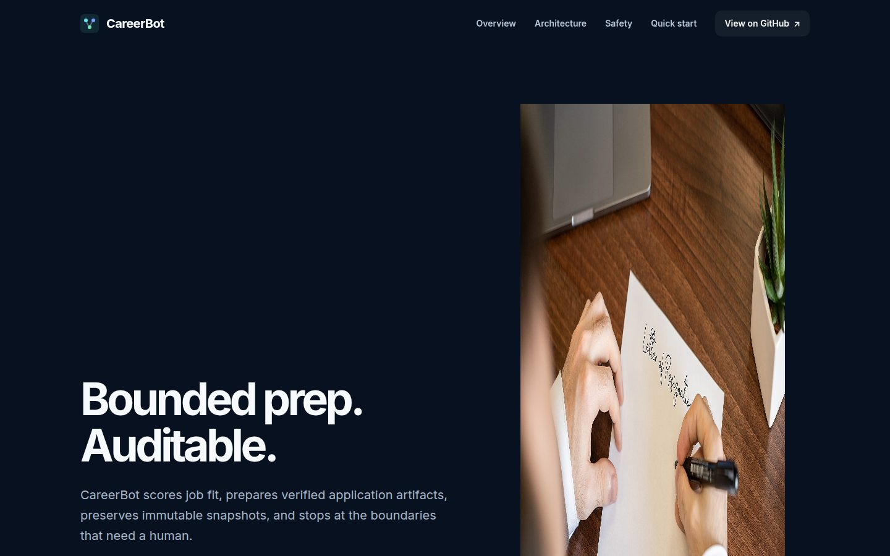
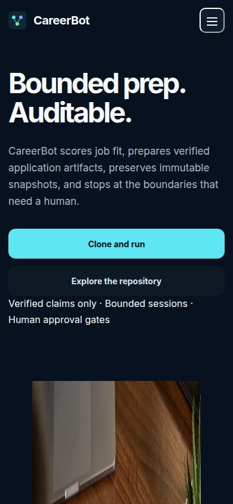

<div align="center">

[](https://www.python.org/)
[](https://modelcontextprotocol.io/)
[](LICENSE)
[](#safety-model)
[](https://sai21112000.github.io/CareerBot/)

### [Visit the live CareerBot website](https://sai21112000.github.io/CareerBot/)




</div>

# CareerBot

CareerBot is an open‑source Python MCP server for bounded, auditable job‑application preparation and tracking. It helps you:

- Normalize and rank supplied jobs (manual input, parsed alerts, permitted adapters)
- Score fit against a private, hash‑verified Master CV using xAI
- Generate role positioning, tailored LaTeX resumes, and concise cover letters
- Enforce deterministic ATS and one‑page PDF checks
- Save immutable application snapshots with SHA‑256 manifests
- Track prepared/submitted applications locally and (optionally) in Airtable

It’s built for explicit handoffs and review—not unattended job‑board automation.

## Features

- Narrow, typed tools exposed over MCP (stdio or authenticated HTTP)
- Dry‑run by default; never submits without explicit approval
- Immutable, verifiable artifacts (PDFs and manifest) for audits
- Explicit submission policy with hard stops (CAPTCHA, MFA, identity, consent, ambiguous answers, restricted platforms)
- Optional Airtable tracking via least‑privilege PAT

## Quickstart

Requirements: Python 3.12+, [Tectonic](https://tectonic-typesetting.github.io/) (for local LaTeX → PDF), and either [uv](https://docs.astral.sh/uv/) or pip.

```bash
git clone https://github.com/Sai21112000/CareerBot.git
cd CareerBot
# with uv (recommended)
uv sync --extra dev
# or with pip
python -m pip install -e .[dev]
```

Create local, private files (kept out of git):

```bash
cp .env.example .env
cp data/master_resume.tex.example data/master_resume.tex
cp AGENTS.md.example AGENTS.md
chmod 600 .env data/master_resume.tex AGENTS.md
```

Replace every `[VERIFIED ...]` marker in `data/master_resume.tex`. Put any supporting sources under the ignored `data/master_cv/` directory. These are the factual boundary for generated claims.

Minimum configuration for model‑backed tools (add to `.env`):

```dotenv
CAREERBOT_XAI_API_KEY=
CAREERBOT_XAI_MODEL=grok-4.6
# Optional Airtable tracking:
# CAREERBOT_AIRTABLE_PAT=
# CAREERBOT_AIRTABLE_BASE_ID=
```

### Run the MCP server (stdio)

```bash
uv run careerbot-mcp
# or, if installed with pip:
careerbot-mcp
```

The committed `.mcp.json` in this repo is already wired for stdio with a conservative `dry_run` profile.

### Run the MCP server (authenticated HTTP)

```bash
CAREERBOT_MCP_TRANSPORT=streamable-http \
CAREERBOT_MCP_HOST=127.0.0.1 \
CAREERBOT_MCP_PORT=8000 \
CAREERBOT_MCP_AUTH_TOKEN='change-me' \
uv run careerbot-mcp
```

Point your remote client at `https://your-host.example/mcp` and use the same bearer token. The bundled static token verifier is for development—use an OAuth/JWT provider in production.

### Connect a client (example)

Cursor-style client entry (stdio) looks like:

```json
{
  "mcpServers": {
    "careerbot": {
      "command": "uv",
      "args": ["run", "careerbot-mcp"],
      "env": {
        "CAREERBOT_EXECUTION_PROFILE": "dry_run",
        "CAREERBOT_MAX_JOBS_PER_RUN": "100",
        "CAREERBOT_MAX_APPLICATIONS_PER_RUN": "10",
        "CAREERBOT_MAX_RUN_MINUTES": "30"
      }
    }
  }
}
```

## MCP tools

All tool names and descriptions are taken from the code in `mcp_servers/job_agent/server.py`.

| Tool | Description |
| --- | --- |
| `consult_career_positioning` | Generate a CV‑grounded career strategy for review without saving it. |
| `save_career_strategy` | Save an explicitly reviewed strategy and an immutable snapshot. |
| `get_career_strategy` | Return the currently approved downstream career strategy. |
| `search_jobs` | Normalize, rank, and deduplicate permitted supplied job data. |
| `score_job` | Score one job against the verified master resume. |
| `tailor_resume` | Tailor the master LaTeX resume and enforce all deterministic rules. |
| `generate_cover_letter` | Generate a concise cover letter grounded in the tailored resume. |
| `save_application_snapshot` | Compile and atomically save a complete immutable application package. |
| `verify_snapshot` | Verify immutable artifact sizes and SHA‑256 hashes. |
| `track_application` | Upsert an application in Airtable when configured and in the CSV backup. |
| `submission_hard_stops` | Return conditions that always require a manual handoff. |
| `assess_submission` | Decide whether an application can use an authorized automatic connector. |

## Safety model

- Default profile is `dry_run`. No shipped command submits to a portal.
- Human approval gates are required for anything beyond local artifact preparation.
- Submission hard stops always trigger a manual handoff: CAPTCHA, MFA, identity verification, consent or declaration, ambiguous answers, restricted platforms, and unsupported connectors.
- Every prepared application snapshot is immutable and auditable: PDFs and metadata are recorded with file sizes and SHA‑256 hashes.

Environment limits (recommended defaults used by `.mcp.json`):

```dotenv
CAREERBOT_MAX_JOBS_PER_RUN=100
CAREERBOT_MAX_APPLICATIONS_PER_RUN=10
CAREERBOT_MAX_RUN_MINUTES=30
```

Profiles:

- `dry_run`: local inspection and simulation
- `review`: prepares artifacts; requires review before any external action
- `auto`: reserved for explicitly authorized connectors that have passed supervised qualification

## Project structure

- `src/job_agent/` — typed domain models, CLI, scoring, strategy, validation, tracking, policy
- `mcp_servers/job_agent/` — FastMCP composition root and the 12 MCP tools
- `.agent/` — optional agent definitions, skills, and bounded workflow runbooks
- `docs/` — static website served by GitHub Pages
- `examples/` — fictional job inputs and command examples
- `data/` — public templates and integration schemas; private runtime files are ignored
- `workspaces/` — per‑platform instructions; active queues and logs are ignored
- `tests/` — offline unit and integration‑contract tests

## Development and tests

```bash
# install with dev extras
uv sync --extra dev
# or: python -m pip install -e .[dev]

# run tests and static checks
python -m pytest
ruff check .
mypy src/job_agent mcp_servers
```

## Website publishing

The project site is a static website in `docs/` and is published with GitHub Pages:

- Settings → Pages → Build and deployment → Source = Deploy from a branch
- Branch: `main`, Folder: `/docs`

## Screenshots

These are generated by the taste‑skill inspector at 1440px and 390px.


## Credits

Pictures used on the site are openly licensed and credited in‑page:

- “Olympia Simplex” by Sammlung der Medien und Wissenschaft, [CC BY 4.0](https://creativecommons.org/licenses/by/4.0), via Wikimedia Commons.
- “Typewriter-12 hg” by Hannes Grobe, [CC BY-SA 4.0](https://creativecommons.org/licenses/by-sa/4.0), via Wikimedia Commons.
- “Cover for ‘Coleccion de Cartas Amorosas Cuaderno No. 6’, a young woman writing a letter at a desk” by José Guadalupe Posada / Antonio Vanegas Arroyo, [CC0](https://creativecommons.org/publicdomain/zero/1.0/deed.en), via Wikimedia Commons.
- “Writing a Letter of Resignation” by CIPHR Connect, [CC BY 2.0](https://creativecommons.org/licenses/by/2.0), via Wikimedia Commons.

## License

CareerBot is released under the [MIT License](LICENSE).
